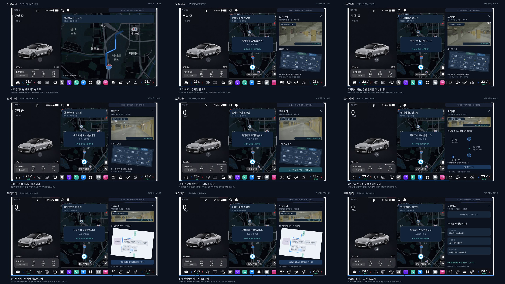

# 백화점 방문 · 도착 이후72초 UX 시연

**이번 대표 검토 영상입니다.** 이동 중 넓은 내비→도착 후3분할→실제 몰 주차장 영상→명시 주차 완료/정차 화면→5층 파란선→닫기를 시간순으로 연결했습니다.

- **[72초 MP4 열기](dochagjari-store-arrival-demo.mp4)** · [직접 다운로드](https://raw.githubusercontent.com/leemh-dev/dochagjari/refs/heads/feat/arrival-context-ux/docs/evidence/demo-video/store-arrival-v2/dochagjari-store-arrival-demo.mp4).
- [완성 MP4에서 추출한 전체 장면표](encoded-storyboard.jpg) · [시간별 콘티](storyboard.json) · [자막 SRT](subtitles.srt).
- [파일/입력 지문·편집 범위·FFprobe](metadata.json) · [검사 보고서](validation.json) · [장면별 앱과 차이](app-comparison.md).
- [설계·다른 시나리오의 자료 규칙](../../../40-synchronized-arrival-demo.md) · [실사 영상 원본·제작자·이용허락](../../../media/mall-parking/README.md).



## 먼저 보실 전환

| 구간 | 확인할 내용 |
| --- | --- |
| 0–8초 | 차량정보 유지, 내비가 두 번째·세 번째 영역 사용. 도착자리 숨김 |
| 8–10초 | 도착 후 내비가 줄고3분할로 전환 |
| 10–28초 | 위 실제 몰 실내 영상 / 아래 주차장 배치 예시 |
| 28–36초 | 두 번째 실사 컷을 역재생·감속해 주차 동작 연출 |
| 36–43초 | 명시 주차 완료, P·0, 같은 정차 프레임 유지 |
| 43–50초 | 상단 정차 썸네일 / 하단 승강시설 확인 안내·수동 열기 |
| 50–66초 | 정차 화면은 그대로, 하단5층 지도에서 파란선 재생 |
| 66–72초 | 닫기/카메라 꺼짐/요약 |

## 실제 수준

**UX 합성 영상입니다. 실제 Pleos3분할/새 앱 녹화가 아닙니다.** 기존 생성 차량/내비 배경과 새 지도/전환을 영상 편집기로 구성했습니다. 실제 주차장 촬영 컷은 Pexels/gusat silviu의 두 원본을 사용했습니다. 판교점/특정 차량 전방카메라/입구부터 주차 완료까지 실제 연속 기록을 확보한 자료는 아닙니다. 주차 완료는 역재생·감속 뒤 같은 프레임을 유지하는 연출이며 실차 검증으로 쓰지 않습니다.

주차 지도는 배치 예시로 실사 장소와 위치 연결이 없습니다. 층·기둥 OCR을 새로 실행하거나 C12/B2 같은 번호를 붙이지 않았습니다.5층 개략도는 기존 앱 catalog 도형/경로를 재현했으며 현재 위치 추적이 아닙니다. 카메라를3D로 변환하지 않았습니다. 일부 장면은 상단 썸네일에 맞춰 원본 상단 절반을 크롭했습니다.

앱0.11.0/11·f0640b0/APK·기존 CI와 저장/복구는 변경하지 않았습니다. [실제 검사 APK](https://github.com/leemh-dev/dochagjari/actions/runs/43569033733/artifacts/14104088875)와 이번 영상 합성을 구분합니다. 새 앱 적용/통합 녹화와 Mac Pleos 실제 배치는 다음 작업입니다. 병원/학원/역/공항 새 연속영상도 아직 미제작입니다.

## 검사와 파일 식별

- 72.000초 /1920×1080/30fps/H.264/yuv420p/2160프레임, 음성·음악 없음.
- 전체 디코딩 rc0, 시간별 장면 계약, 주차 후 카메라 원본 동일/하단 경로 변경을 대조했습니다.8개 항목은 **영상 검사**이며 Android 테스트 건수가 아닙니다.
- 정차39/41초 카메라 디코딩 픽셀 차이0. 정차 썸네일47/61초의 인코딩 전 입력은 지문까지 동일합니다. 손실 압축 후 픽셀 차이는 평균1.972/255이며 차이를 이동으로 판정하지 않았습니다.
- 실제 출력1,838,396bytes. SHA256:

```text
83aae6a4fb30caad7b9d8d714962564112354e9604ff8daa4d5df2bb6fff9408
```

재현(저장소 루트, Python/Pillow/NumPy·FFmpeg/FFprobe·시스템 NotoSansCJK 필요):

```bash
python3 scripts/render_store_arrival_demo.py --output /tmp/dochagjari-store-demo
python3 scripts/verify_store_arrival_demo.py --output /tmp/dochagjari-store-demo
```

렌더링 파일은 실제 앱 구현의 비교 기준입니다. 영상에 보이는 성공을 앱 기능 성공으로 복사하지 않으며 [차이표](app-comparison.md)에 따라 다음 개발·실제 실행·비교를 진행합니다.
