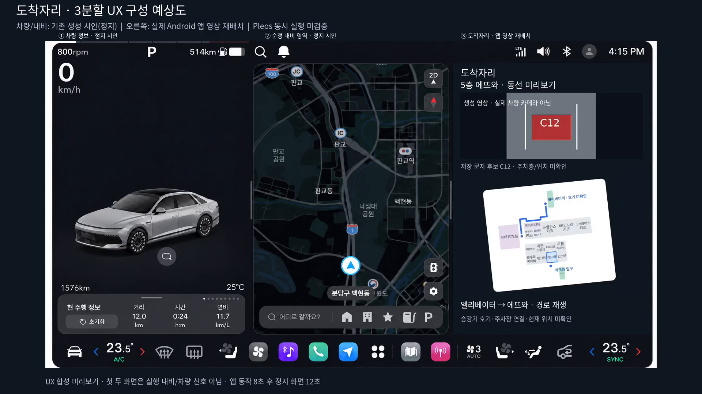

# 3분할 UX 합성 예상도

**실제 Pleos 동시 실행 영상이 아니다.** 왼쪽 차량 정보와 가운데 내비는 기존 승인된 생성 시안의 정지 배경이고, 오른쪽은 일반 Android 앱0.11.0/11·f0640b0에서 실제 녹화한 카메라/5층 경로 영역을 영상 편집기로 재배치했다. APK 안에서 이3분할을 실행했다는 증거로 쓰지 않는다.

- [20초 구성 예상도 MP4](dochagjari-three-panel-concept.mp4)
- [대표 프레임](preview.png) · [원본 지문/합성 범위/FFprobe](metadata.json)



첫 두 영역은 `docs/ux/photo-based-3d/05-camera-and-3d-map.png`의 기존 차량/내비 구성을 사용했다. 원본 파일은 변경하지 않았고 카메라2F/227을 포함한 원래 오른쪽 카드는 전부 가렸다. 첫 두 화면의 표시값/화살표는 실제 차량 신호나 현재 내비 경로가 아니다. 패널 구분 표시는 차량 계기를 가리지 않도록 프레임 바깥에 둔다.

오른쪽 카메라는 실제 앱이 재생한 생성 C12클립이다. 실제 OEM카메라가 아니다. 지도선은 원본 앱 녹화46.5초부터8초의 실제 동작을 사용하고, 이후12초는 마지막 프레임 정지다. C12는 문자후보이며 주차층/현재위치/승강호기를 확정하지 않는다. 합성/정지시안/일반Android 재배치/실제Pleos미검증을 영상 내내 표시한다.

출력1920×1080/30fps/H.264/20.000초, 전체 디코딩과 프레임·파일SHA256을 확인했다. [렌더 스크립트](../../../../scripts/render_three_panel_concept.py)는 저장소 루트에서 실행한다.

```bash
python3 scripts/render_three_panel_concept.py --output /tmp/dochagjari-three-panel
```

원했던 실제3분할 대표시연은 **Mac Pleos에서 차량정보·실행 중인 순정내비·도착자리 앱을 같은 전체화면 녹화로 확보하는 것**이다. 이 합성 예상도로 대체하지 않는다. 기존 앱 단독90초/20초 기능기록도 보존한다.
