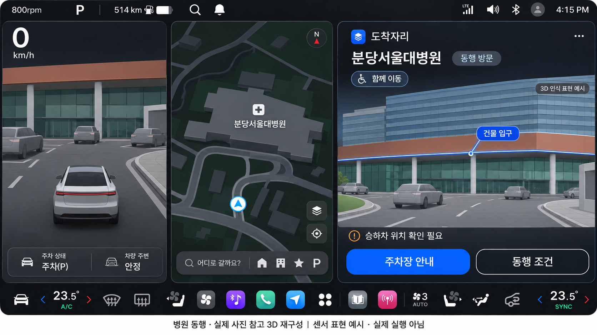
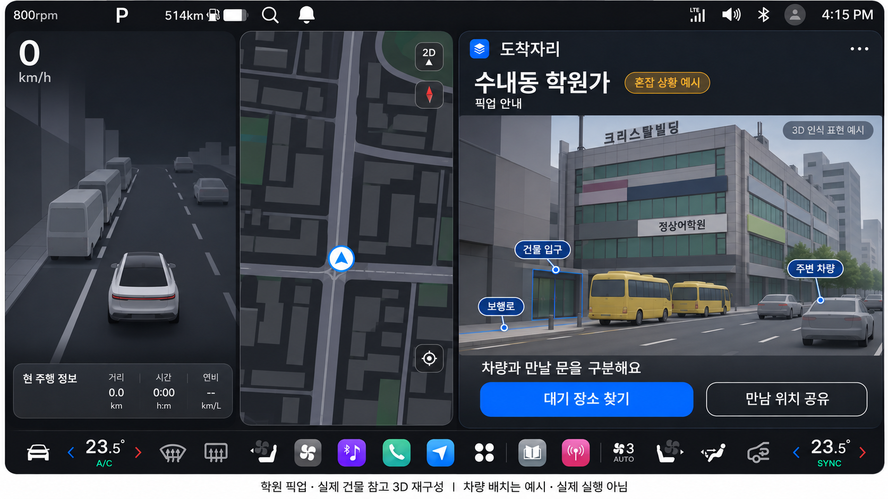
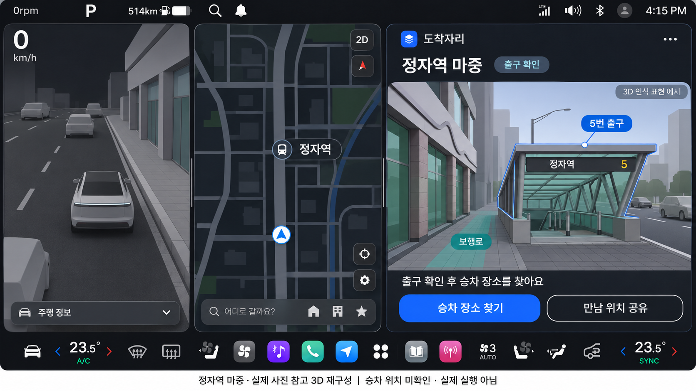
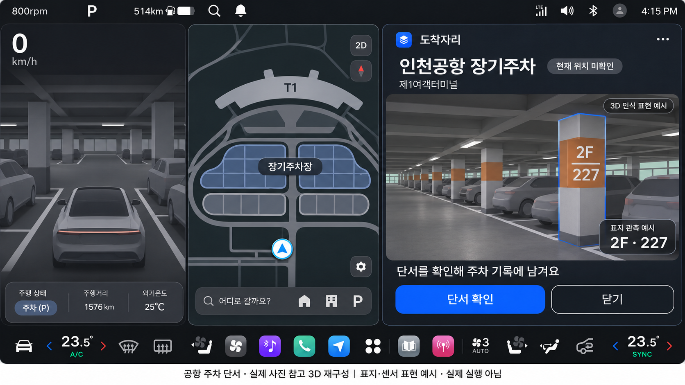

# 실제 사진 참고 · 3D 화면 시안

2026-11-13. 차량 주변 화면 / 내비 / 도착자리의 3분할 예상도. **생성 디자인이며 실제 앱·센서·Pleos 내비 실행 화면이 아니다.** [설계와 한계](../../29-photo-based-3d-ux.md) · [생성 지시·출처·이미지 식별](metadata.json) · [원본 사진 조사](../../28-real-place-photo-research.md).

## 병원 동행

실제 병원 외관을 단순화하고 건물 입구를 찾는 방향을 강조했다. 승하차 허용점/무단차 경로는 미확인이다.

## 학원 픽업

실제 수내동 크리스탈빌딩을 참고했다. 차량·셔틀 위치와 혼잡은 예시이며 학부모 픽업 현장을 재현한 증거가 아니다.

## 정자역 마중

실제 5번 출구 형태를 참고했다. 사람 출구 확인과 차량 승차 장소 찾기를 구분한다.

## 공항 주차 단서

사진에 보이는 2F·227을 표지 관측 표현에 사용했다. 현재 위치와 터미널/승강기 연결은 확인하지 않았다.

모든 PNG는 1672×941이며 생성 원본을 변경 없이 복사했다. 참고 사진은 배포 자산으로 포함하지 않았다. 상단 차량 정보·가운데 지도/자차·하단 공조도 개념도이며 차량 신호 수신 결과가 아니다.
