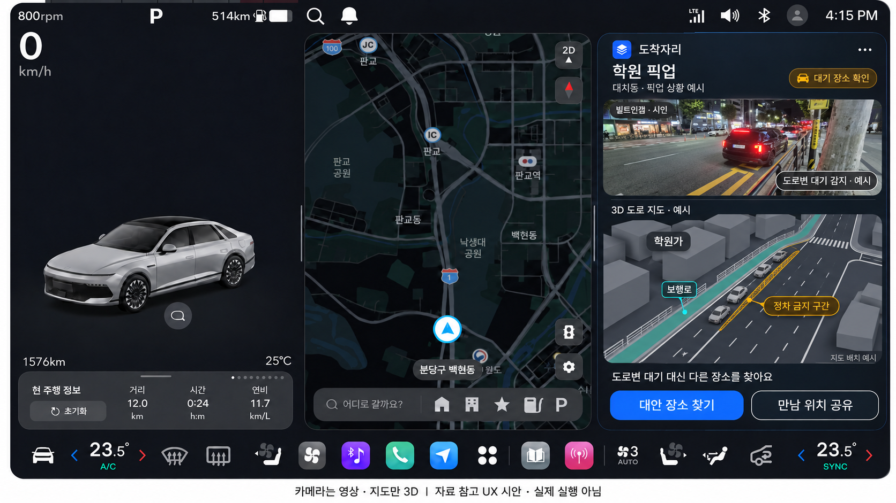
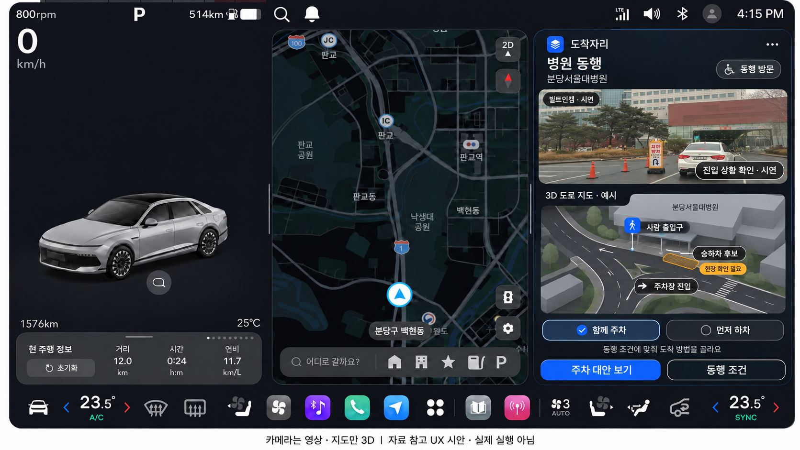
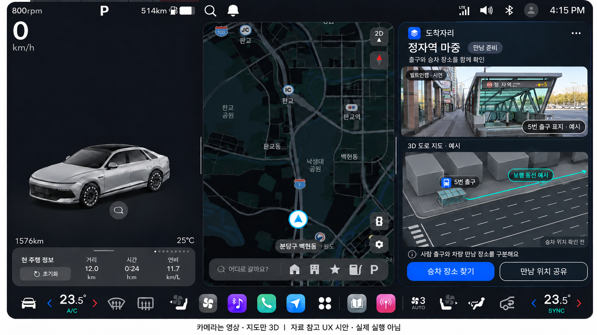
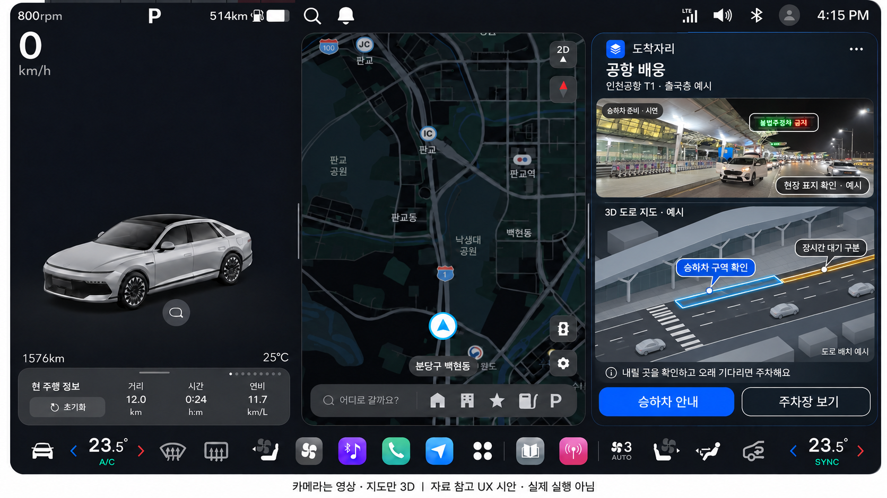

# 도로변 시나리오 · 카메라 + 3D지도

2026-11-13. **생성 디자인 시안4장. 실제 앱/카메라/SDK 실행 증거가 아니다.** 첫 번째 차량정보·두 번째 내비 구성을 유지하고 세 번째 상단에 카메라 영상 형태, 하단에 기울인3D도로지도를 배치했다. 가운데 지도는 기준 디자인 배경이며 실제 목적지 경로가 아니다. [설계/경계/수정 기록](../../31-road-scenario-ux-concepts.md) · [참고출처/지시/치수/SHA256](metadata.json) · [원본 사진 조사](../../30-road-ui-reference-review.md).

## 학원 픽업

대치동 참고 사진. 정차금지 구간의 대기 상황에서 대안 장소를 찾는 장면이다. 지도 배치·카메라 감지는 예시이며 현재 분당 현장이 아니다.

## 병원 동행

분당서울대병원 진입 사진 참고. 사람 출입구/주차장 진입과 승하차 후보를 구분하고 함께 주차/먼저 하차를 비교한다. 승하차 허용점·무단차 연결은 미확인이다.

## 정자역 마중

5번출구와 보행동선 예시를 표시한다. 차로를 승차점처럼 보이게 했던 초기 파란 영역은 최종본에서 제거했다. 차량 승차 위치는 확인 전이다.

## 공항 배웅

인천공항T1 출국층 사진 참고. 승하차와 긴 대기/주차를 구분한다. 지도상의 구역은 예시이며 입국 마중 장소나 확인된 허용 정차점을 뜻하지 않는다.

생성 원본은 수정 없이 복사해 저장했다. 병원 PNG의 실제 폭은1671, 나머지는1672이며 높이는 모두941이다. 원본의 실제 값은 metadata를 따른다. 이전 매장/주차장 디자인과 앱은 유지한다.
