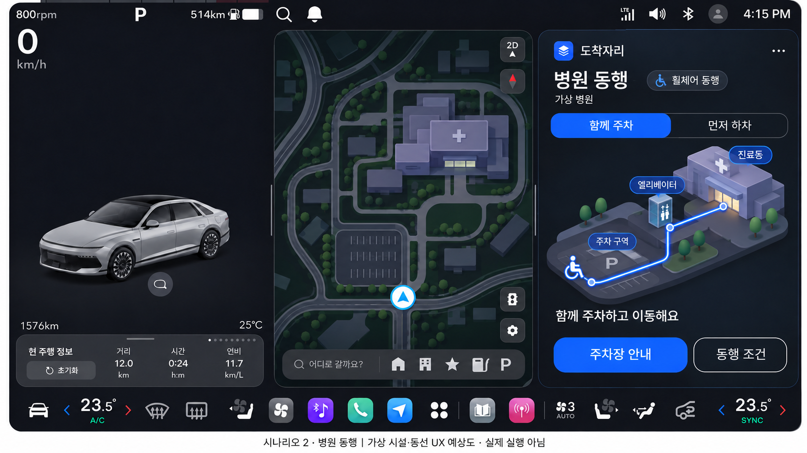
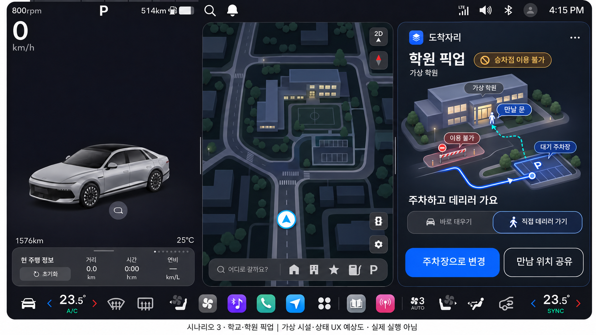
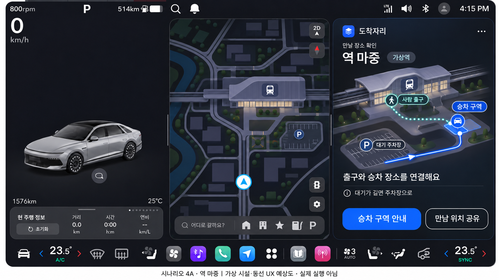
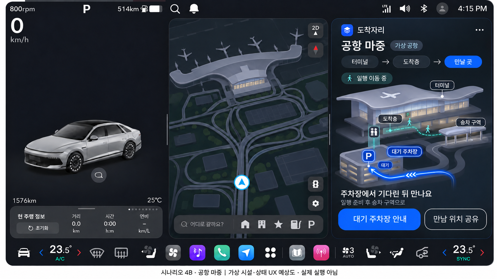

# 도착자리 시나리오별 Pleos UX 예상도

2026-11-13 UTC. **AI 생성 정적 디자인 시안**이다. 실제 Pleos/Android 실행 화면·공식 지도·현재 위치·SDK 연동 성공이 아니다. 병원/학원/역/공항과 표시된 동선·이용 가능 상태는 가상 예시다. 모든 장면은 P·0km/h인 정차 상태다. 사용자 정의/범위는 [서비스 기획](../../01-product-plan.md), 전환 규칙과 구현 경계는 [docs27](../../27-scenario-ux-concepts.md)을 따른다.

매장 시안의 어두운 화면·큰 한국어 글씨·파란 경로를 공통으로 사용했다. 왼쪽 시스템 차량 영역과 중앙 순정 내비 모형은 플랫폼 배치의 설명이며 도착자리 앱이 구현/복제한 화면이 아니다. 생성 이미지의 글꼴 인상은 실제 Pretendard 파일 적용이나 라이선스 확인의 증거가 아니다.

| 화면 | 핵심 전달 | 파일 |
| --- | --- | --- |
| 1. 매장 방문 | 기존 승인 스타일 기준. 이번에 새로 생성한 화면이 아님 | [매장 기준](01-store-reference.png) |
| 2. 병원 동행 | 함께 주차→승강기→진료동, 동행 방식 선택 | [병원](02-hospital-companion.png) |
| 3. 학교·학원 픽업 | 막힌 승차점→대기 주차장, 운전자가 직접 데리러 가는 보행 연결 | [픽업](03-academy-pickup.png) |
| 4A. 역 마중 | 사람 출구/차량 승차 구역/대기 주차장을 구분 | [역](04a-station-pickup.png) |
| 4B. 공항 마중 | 일행 이동 중에는 주차 대기, 준비된 뒤 승차 구역으로 전환 | [공항 최종 수정본](04b-airport-waiting.png) |

## 공항 시안 수정

초안은 '대기 주차장 안내' 버튼과 달리 파란 차량 선이 주차장에서 승차 구역으로 향했다. 이미지 생성 도구로 수정해 최종 파란 선이 대기 주차장에서 끝나도록 했다. 승차 구역으로 이어지는 청록 보행선과 '일행 준비 후 승차 구역으로' 문구는 다음 단계의 계획이다. 일행 실제 위치/항공편 연동이 아니다. 초안은 workspace 원본에 보존하고 GitHub에는 최종본을 제공한다.

[PNG 크기·SHA-256·수정 이력](image-metadata.json). 네 최종 시안과 이전 매장 기준을 원본 PNG 그대로 저장했다. 앱0.9.0/9·코드e2b93ba·APK/검증 수준은 바꾸지 않았다.
